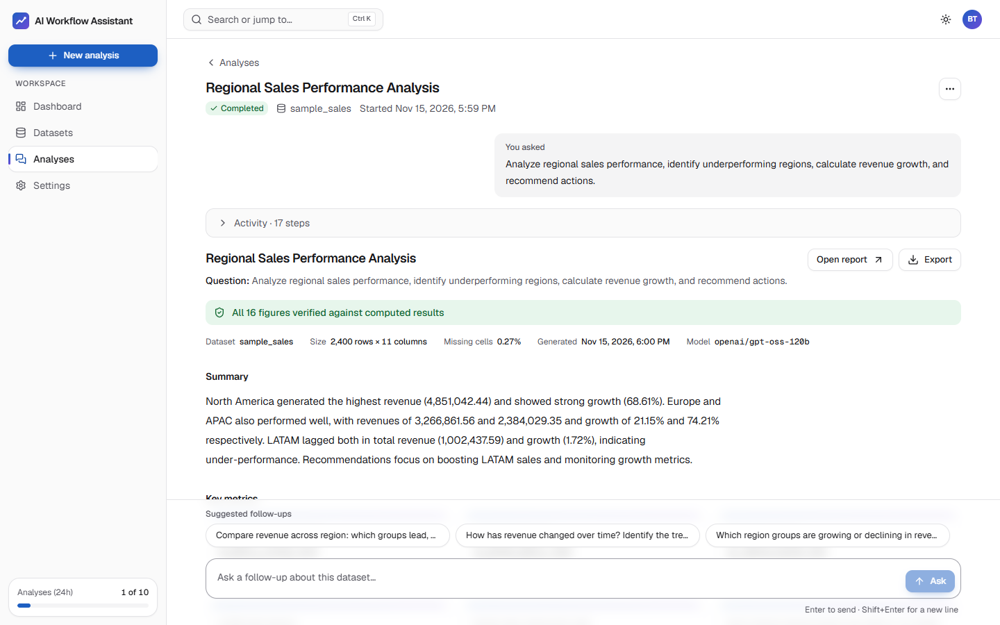
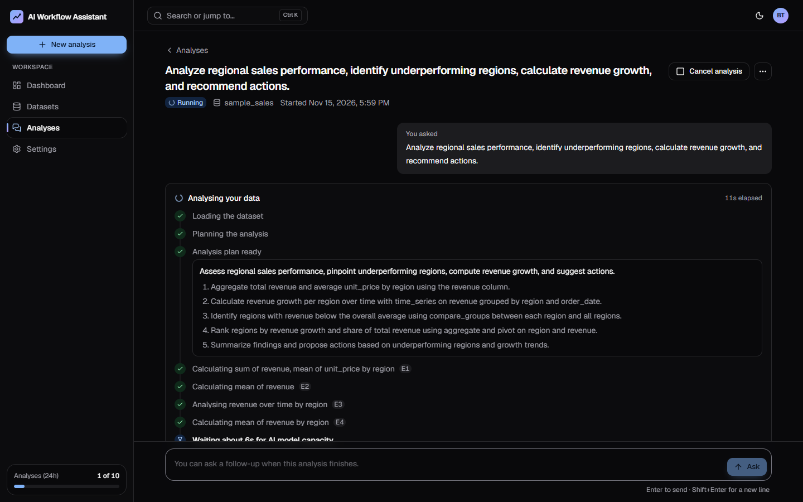
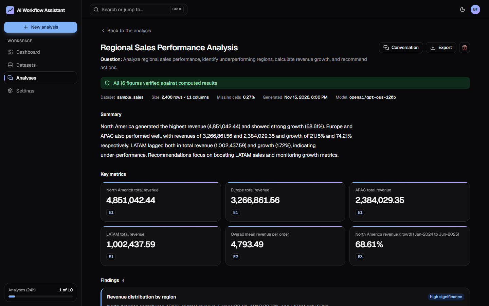
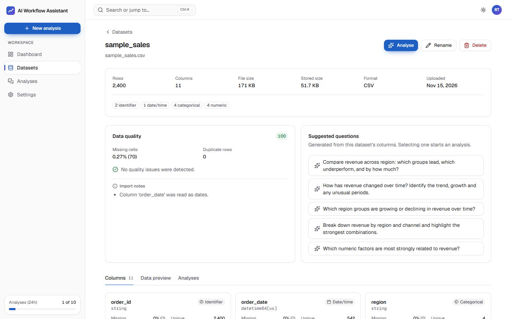
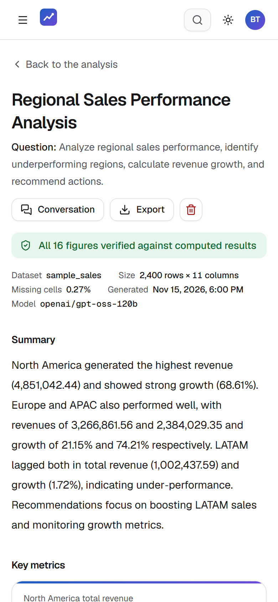

# AI Workflow Assistant

[](https://ai-workflow-assistant-app.vercel.app)
[](https://github.com/syed-waleed-ahmed/AI-Workflow-Assistant/actions/workflows/ci.yml)
[](https://github.com/syed-waleed-ahmed/AI-Workflow-Assistant/actions/workflows/health-check.yml)
[](LICENSE)

An AI data analyst for your spreadsheets. Upload a CSV or Excel file, ask a question in plain
language, and get a report with key metrics, charts, findings and recommendations — in which
**every number was computed by pandas and checked against that computation before you see it**.

The language model plans the analysis and writes the narrative. It never does the arithmetic.

**Live:** <https://ai-workflow-assistant-app.vercel.app> — create an account and try the bundled
sample dataset. It runs on free tiers, so the first request after a quiet spell can take about
a minute while the API wakes up.



| Live progress | Report | Dataset profile | Phone |
| --- | --- | --- | --- |
|  |  |  |  |

All screenshots are from a real run on the bundled sample dataset. [Full report page](docs/screenshots/report.png).

## What it does

- **Datasets.** Upload CSV, TSV, XLSX or XLS. Files are validated, typed (numbers written as
  `$1,200.50` or `45%`, dates, categories), profiled for quality, and stored privately.
- **Analysis.** A LangGraph agent plans the work, calls deterministic analytical tools, and
  writes a structured report. Progress is shown live as it happens.
- **Verification.** Each figure in a report is traced to a tool result. Figures that cannot be
  traced are corrected, or flagged in the report if they persist.
- **Provenance.** Every metric and finding links to the computation behind it, with the
  underlying table.
- **Follow-ups.** Ask further questions in the same conversation.
- **Reports.** Saved with the analysis that produced them; export as Markdown, PDF, Excel or CSV.
- **Accounts.** Each user's datasets, analyses and reports are private to them.

### Analytical tools

| Area | Tools |
| --- | --- |
| Business metrics | `aggregate` (totals, averages, rankings, share of total), `pivot`, `rate_metric` (conversion rates, ratios), `segment` (value tiers, concentration) |
| Time | `time_series` (trend, period-over-period change, rolling average, linear forecast when justified), `compare_periods`, `time_anomalies` |
| Statistics | `column_statistics`, `value_counts`, `distribution`, `correlation` (with p-values), `scatter`, `compare_groups` (Welch t-test), `outliers` |
| Data | `data_quality`, `filter_rows` |

Filters are structured conditions and calculated columns are validated arithmetic. Nothing the
model writes is ever executed as code.

## How it works

```text
 question ─► plan ─► agent ⇄ tools ─► verify ─► report ─► ground ─► verified report
                       (ReAct loop)     │                    │
                                        │                    └ every number checked against tool results
                                        └ were results actually computed?
```

The `agent ⇄ tools` loop is the ReAct agent this project started as; planning, verification,
structured reporting and numeric grounding were added around it.
[docs/architecture.md](docs/architecture.md) explains the design and the reasons behind it.

## Tech stack

| Layer | Technology |
| --- | --- |
| Frontend | Next.js (App Router), React, TypeScript (strict), Tailwind CSS, shadcn/ui, cmdk, Recharts, Motion, TanStack Query, React Hook Form, Zod |
| Backend | Python 3.12, FastAPI, Pydantic, SQLAlchemy 2, Alembic |
| Agent | LangGraph, LangChain Core, Groq (`openai/gpt-oss-120b`) |
| Data | pandas, NumPy, PyArrow (Parquet), openpyxl |
| Storage | PostgreSQL; S3-compatible object storage |
| Quality | pytest, Ruff, mypy (strict), Vitest, Testing Library, ESLint, Prettier, GitHub Actions |

## Run it locally

You need Python 3.11+, Node.js 20+ and a free [Groq API key](https://console.groq.com/keys).
Local development uses SQLite and stores files on disk, so there is nothing else to install.

### Backend

```bash
cd backend
python -m venv .venv
.venv/Scripts/activate            # Windows; on macOS/Linux: source .venv/bin/activate
pip install -r requirements-dev.txt
cp .env.example .env              # then set GROQ_API_KEY in .env
alembic upgrade head
uvicorn app.main:app --reload --port 8000
```

API documentation is served at <http://localhost:8000/docs>.

### Frontend

```bash
cd frontend
npm install
cp .env.example .env.local
npm run dev
```

Open <http://localhost:3000>, create an account, and try the bundled sample dataset.

### Command line

The original interface still works, on the new engine, with no database or account:

```bash
cd backend
python -m app.cli --data ../data/sample_sales.csv \
  --task "Analyze regional sales performance and recommend actions." \
  --output report.md
```

## Configuration

Settings are environment variables; `backend/.env.example` and `frontend/.env.example` list
them all. The essentials:

| Variable | Where | Purpose |
| --- | --- | --- |
| `GROQ_API_KEY` | backend | Model access. |
| `GROQ_MODEL` | backend | Defaults to `openai/gpt-oss-120b`. |
| `DATABASE_URL` | backend | SQLite locally, PostgreSQL in production. |
| `STORAGE_BACKEND`, `S3_*` | backend | `local` or any S3-compatible service. |
| `SECRET_KEY` | backend | Required in production. |
| `BACKEND_URL` | frontend | Where the frontend proxies `/api`. |
| `NEXT_PUBLIC_API_DIRECT_URL` | frontend | Backend URL for direct file uploads (production). |
| `PROXY_SHARED_SECRET` | both | Same value on each side, so per-address sign-in limits see the visitor's address (production). |

## Supported files and limits

| | Default | Free-tier deployment |
| --- | --- | --- |
| Formats | `.csv`, `.tsv`, `.xlsx`, `.xls` | same |
| File size | 20 MB | 10 MB |
| Rows / columns | 250,000 / 200 | 150,000 / 200 |
| Datasets per user | 25, up to 100 MB stored | same |
| Analyses per user | 10 per 24 hours, one at a time | same |

Multi-sheet workbooks ask which sheet to import. Formulas and macros are never executed; only
stored values are read. Limits are configurable, and the reasons for the free-tier values are
in [docs/deployment.md](docs/deployment.md).

## Tests

```bash
cd backend && pytest            # 375 tests; the model is scripted, nothing calls Groq
cd frontend && npm run test     # 133 tests (Vitest, Testing Library, axe)
```

The backend suite covers the tools against hand-computed values, the expression and filter
sandboxes, upload validation, numeric grounding, the full agent workflow, the HTTP API, tenant
isolation on every resource route, and exports. Two further tests call the real Groq API and
run only on request: `LIVE_GROQ_API_KEY=... pytest -m live`.

Two scripts check a running deployment, local or hosted. Each makes throwaway accounts and
deletes them afterwards:

- `backend/scripts/smoke_test.py --base-url <url>` walks the API journey (41 checks).
- `frontend/e2e/journey.mjs`, run as `BASE_URL=<url> npm run e2e`, drives the real UI in
  Chrome or Edge (36 checks). It covers upload, a real analysis, the report, exports, both
  themes, phone-width layout and sign-out/sign-in, and saves screenshots.

## API

Interactive documentation: `/docs` on the backend. The OpenAPI schema is committed at
[docs/openapi.json](docs/openapi.json).

| Method and path | Purpose |
| --- | --- |
| `POST /api/v1/auth/register` · `login` · `logout`, `GET /auth/me` | Accounts and sessions |
| `PATCH /api/v1/users/me`, `POST /users/me/password`, `GET /users/me/usage`, `POST /users/me/delete` | Profile, usage, account deletion |
| `POST /api/v1/datasets`, `GET /datasets`, `GET /datasets/{id}`, `GET /datasets/{id}/preview`, `GET /datasets/{id}/suggestions`, `PATCH` / `DELETE /datasets/{id}` | Datasets |
| `POST /api/v1/analyses`, `POST /analyses/{id}/messages`, `GET /analyses/{id}/events`, `POST /analyses/{id}/cancel`, `GET` / `DELETE /analyses/{id}` | Analyses and follow-ups |
| `GET /api/v1/reports`, `GET /reports/{id}`, `GET /reports/{id}/export?format=md\|pdf\|xlsx\|csv`, `DELETE /reports/{id}` | Reports and exports |
| `GET /health`, `GET /ready` | Liveness and readiness |

Analyses run in the background: `POST /analyses` returns `202`, and the client polls
`/analyses/{id}/events` for progress.

## Deployment

The project deploys on free tiers: Vercel (frontend), Render (API), Supabase (PostgreSQL and
file storage) and Groq (model). [docs/deployment.md](docs/deployment.md) has the step-by-step guide, the
limits those tiers impose, and the upgrade path.

## Security

Passwords are hashed with Argon2id; sessions are HttpOnly cookies with CSRF protection; every
query is scoped to the signed-in user; uploads are validated from their content; and the model
cannot execute code. [SECURITY.md](SECURITY.md) covers the threat model, what is tested, and
what is not implemented.

## Known limitations

- **Free-tier capacity.** On Groq's free tier an analysis takes about a minute and the whole
  deployment can run roughly a dozen a day.
- **Verification covers numbers, not wording.** A figure is guaranteed to match a computation;
  the sentence around it is the model's. Each claim links to its evidence so you can check.
- **No password reset or email verification.** There is no email provider.
- **One dataset per analysis.** Joining datasets is not supported.
- **Data transformations are per-question.** Filters and calculated columns apply within an
  analysis; there is no persistent data-cleaning step or dataset versioning.

## Project documents

- [Architecture](docs/architecture.md) — design and trade-offs
- [Security](SECURITY.md) — threat model and controls
- [Deployment](docs/deployment.md) — hosting, limits, upgrade path
- [Contributing](CONTRIBUTING.md) — conventions and checks

## Author

Created by Syed Waleed Ahmed.

## License

[MIT](LICENSE)
